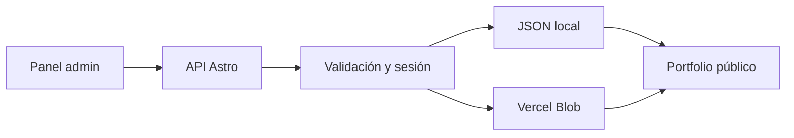

# Arquitectura del portfolio

## Capas

1. **Presentación pública.** La portada reúne toda la información esencial. Los proyectos destacados se abren en diálogos y sus imágenes cambian automáticamente.
2. **Archivo de trabajos.** `/trabajos` muestra todos los proyectos visibles y `/trabajos/[slug]` desarrolla cada caso.
3. **Administración.** `/admin` presenta formularios y listados para gestionar la información sin editar archivos a mano.
4. **API.** Las rutas de `src/pages/api` validan solicitudes, archivos y permisos.
5. **Dominio y persistencia.** `src/server` normaliza los datos y usa JSON local en desarrollo o Vercel Blob en producción.

## Flujo de datos



## Carpetas principales

```text
data/
  portfolio.json
public/
  demo/
  uploads/
src/
  components/
  layouts/
  pages/
    admin.astro
    api/
    trabajos/
  scripts/
    admin.js
    page.js
  server/
    http.js
    portfolio.repository.js
    record.normalizers.js
    storage.service.js
    upload.service.js
  styles/
```

## Accesibilidad e interacción

- HTML semántico, encabezados jerárquicos y enlace para saltar al contenido.
- Diálogos nativos con cierre mediante botón, fondo o tecla `Esc`.
- Restauración del foco al cerrar un caso.
- Formularios con etiquetas visibles, errores legibles y estados de carga.
- Descripciones alternativas para cada imagen de proyecto.
- Transiciones desactivadas cuando el sistema solicita movimiento reducido.
- Navegación y panel responsive para notebook y celular.

## Seguridad y límites

En desarrollo se puede escribir sin clave; en producción se exige `PORTFOLIO_ADMIN_KEY` y una sesión firmada. La base y las cargas se guardan en Vercel Blob para sobrevivir despliegues y reinicios. Cada archivo puede pesar hasta 4 MB.
